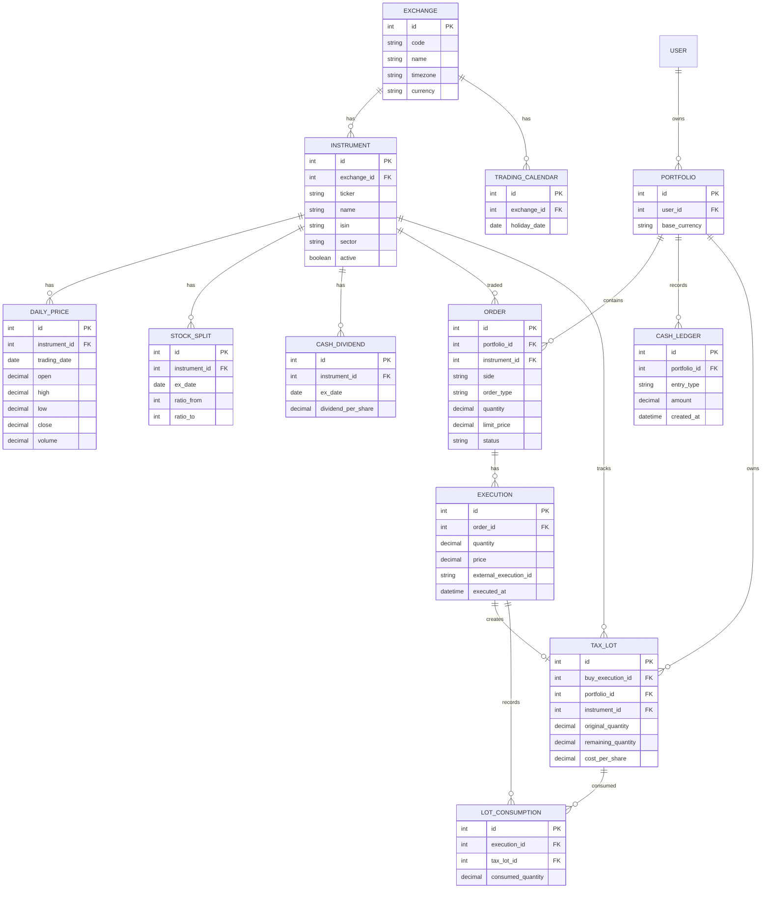

# Stock Portfolio Management System

A Django REST Framework-based stock portfolio management backend built with PostgreSQL. It supports stock orders, partial executions, cash ledger tracking, FIFO tax lot accounting, corporate action processing, portfolio valuation, and reporting APIs.

## Tech Stack

- Python 3.11
- Django 5.2
- Django REST Framework
- PostgreSQL
- Docker and Docker Compose

## Features

- Exchange and instrument management
- Daily OHLCV stock price records
- Stock split and cash dividend processing
- Multiple portfolios per user
- BUY and SELL order creation
- MARKET and LIMIT order types
- Partial order executions
- Pending BUY cash reservation and SELL share availability checks
- Cash ledger tracking
- FIFO-based tax lot accounting
- External execution ID uniqueness
- Portfolio holdings and historical valuation APIs
- Realized P&L reporting
- Top 10 movers reporting
- 20-row moving average calculation using a database window function
- CSV price import with batch processing and upsert support
- Database constraints and transaction-based operations

## Project Setup

### 1. Clone the Repository

```bash
git clone https://github.com/BhagyashreeChouhan/StockPortfolio.git
cd StockPortfolio
```

### 2. Configure Environment Variables

Create a `.env` file in the project root:

```env
DB_NAME=stock_portfolio
DB_USER=postgres
DB_PASSWORD=your_password
DB_HOST=localhost
DB_PORT=5432
SECRET_KEY=your_generated_secret_key
```

Use the credentials configured for your local PostgreSQL database. Keep `.env` out of version control.

### 3. Create a Virtual Environment

**Windows:**

```powershell
python -m venv venv
venv\Scripts\activate
```

### 4. Install Dependencies

```bash
pip install -r requirements.txt
```

### 5. Apply Database Migrations

```bash
python manage.py migrate
```

### 6. Start the Development Server

```bash
python manage.py runserver
```

The API routes are available under:

```text
http://127.0.0.1:8000/api/
```

## Docker Setup

Docker and Docker Compose must be installed.

Start the application:

```bash
docker compose up --build
```

This starts PostgreSQL and the Django development server. Database migrations are applied automatically when the web container starts.

The API routes are available under:

```text
http://localhost:8000/api/
```

Stop the application:

```bash
docker compose down
```

PostgreSQL data is persisted using the `postgres_data` Docker volume.

The Docker Compose configuration reads `SECRET_KEY` from the environment. Make sure it is configured before starting the application.

## API Endpoints

All API views require authentication.

| Method | Endpoint | Description |
|---|---|---|
| POST | `/api/orders/` | Create a BUY or SELL order |
| POST | `/api/orders/{order_id}/executions/` | Add an execution to an order |
| GET | `/api/portfolios/{portfolio_id}/holdings/` | Retrieve portfolio holdings |
| GET | `/api/portfolios/{portfolio_id}/value/` | Retrieve historical portfolio value |
| GET | `/api/portfolios/{portfolio_id}/realized-pnl/` | Retrieve realized P&L by instrument |
| GET | `/api/exchanges/{exchange_id}/top-movers/` | Retrieve the top 10 movers for an exchange |
| GET | `/api/instruments/{instrument_id}/moving-average/` | Retrieve moving average data |

### Query Parameters

**Historical Portfolio Value**

```text
GET /api/portfolios/{portfolio_id}/value/?as_of=2026-11-25
```

The API calculates cash balance and stock value as of the supplied date. It uses the latest available closing price on or before that date.

**Realized P&L**

```text
GET /api/portfolios/{portfolio_id}/realized-pnl/?start_date=2026-11-01&end_date=2026-11-25
```

Both dates are required. The response groups realized P&L by instrument using FIFO lot consumption records.

**Top Movers**

```text
GET /api/exchanges/{exchange_id}/top-movers/?start_date=2026-11-01&end_date=2026-11-25
```

Both dates are required, and the end date must be after the start date. The API considers instruments with executions during the selected period and returns up to 10 instruments ordered by percentage price change.

## Management Commands

### 1. Import Daily Prices from CSV

```bash
python manage.py load_prices sample_prices.csv
```

The CSV file must contain these columns:

- `exchange_code`
- `ticker`
- `trading_date`
- `open`
- `high`
- `low`
- `close`
- `volume`

The import command:

- Processes records in batches of 5,000.
- Uses `bulk_create` with a database batch size of 1,000.
- Inserts new price records and updates existing records using the instrument and trading date as the conflict fields.
- Validates instrument, date, numeric values, OHLC relationships, and volume.
- Skips invalid rows without stopping the entire import.
- Generates an error report next to the input CSV with the `_errors.csv` suffix.

Example output:

```text
Successfully processed 2 price rows.
Invalid rows skipped: 1
Error report: sample_prices_errors.csv
```

The number of processed rows includes records inserted or updated.

**Note:** A benchmark using approximately one million rows has not been performed, so no import-time performance figure is claimed.

### 2. Process Corporate Actions

```bash
python manage.py process_corporate_actions 2026-11-26
```

The command processes stock splits and cash dividends for the supplied ex-date.

- Stock splits adjust applicable tax lot quantities and cost per share while preserving total cost basis.
- Cash dividends are calculated using the remaining quantities of matching tax lots and recorded in the cash ledger for eligible portfolios.

## Entity Relationship Diagram



## Design Decisions

### 1. Portfolio Positions

Portfolio holdings are calculated from `TaxLot` records instead of maintaining a separate positions table.

The remaining quantity of each tax lot is aggregated to calculate:

- Total quantity
- Average cost
- Latest price
- Market value
- Unrealized P&L
- Portfolio percentage

The portfolio percentage in the holdings API is calculated against the total market value of the holdings.

### 2. Cash Balance

Cash balance is derived from the sum of `CashLedger` entries.

BUY executions create negative ledger entries, SELL executions create positive entries, and dividend processing creates positive dividend entries.

The `CashLedger` model also defines entry types for deposits, withdrawals, and fees. The ledger model prevents normal instance-level updates and deletions after creation.

### 3. FIFO Tax Lot Accounting

Every BUY execution creates a `TaxLot`.

When shares are sold, available tax lots are consumed in FIFO order (First In, First Out). Each consumption is recorded in `LotConsumption`.

Realized P&L is calculated from execution proceeds minus the cost of the consumed tax lots.

### 4. Order Placement and Execution

Order placement and execution use `transaction.atomic()` and `select_for_update()`.

- BUY orders check the available cash after accounting for pending BUY order reservations.
- SELL orders check available shares after accounting for pending SELL order reservations.
- MARKET order reservation uses the latest available closing price.
- LIMIT order reservation uses the limit price.
- Execution processing locks the portfolio and order.
- Partial executions update the order status.
- Execution quantity cannot exceed the remaining order quantity.

These operations help prevent concurrent requests from spending the same cash or selling the same available shares.

### 5. Execution Idempotency

`Execution.external_execution_id` has a conditional unique constraint for non-null values.

This prevents duplicate external execution identifiers at the database level.

### 6. Corporate Actions

Stock split processing adjusts the original quantity, remaining quantity, and cost per share of applicable tax lots.

The total cost basis is preserved.

Dividend processing creates cash ledger entries based on the remaining quantities of matching tax lots for portfolios holding the instrument when the command is processed.

### 7. Database Constraints

The project uses database-level unique and check constraints for data integrity.

| Model | Constraint |
|---|---|
| Instrument | Unique ticker within an exchange |
| Instrument | Globally unique ISIN |
| DailyPrice | Unique instrument and trading date |
| DailyPrice | Low must be less than or equal to open |
| DailyPrice | Close must be less than or equal to high |
| DailyPrice | Volume must be non-negative |
| StockSplit | Both split ratio values must be positive |
| CashDividend | Dividend per share must be non-negative |
| TradingCalendar | Unique exchange and holiday date |
| Order | Positive quantity |
| Order | Valid side, order type, and status |
| Order | LIMIT orders require a positive limit price; MARKET orders require a null limit price |
| Execution | Positive quantity and price |
| Execution | Unique non-null external execution ID |
| CashLedger | Valid entry type and corresponding amount sign |
| TaxLot | Positive original quantity and cost per share; remaining quantity cannot be negative or exceed original quantity |
| LotConsumption | Positive consumed quantity and unique execution/tax lot pair |

### 8. Delete Behaviour

Foreign-key relationships use `on_delete=PROTECT`.

This prevents referenced records such as instruments, orders, executions, portfolios, and tax lots from being deleted while dependent records exist.

### 9. Date and Time Handling

Django is configured with `USE_TZ=True` and `TIME_ZONE="UTC"`.

Execution and ledger timestamps use Django's timezone-aware datetime fields. Trading dates are stored separately using `DateField`, and the exchange timezone is stored on the `Exchange` model.

## Indexes and Query Optimization

The project does not define additional custom indexes through `Meta.indexes`.

Django creates indexes for ForeignKey fields. Unique constraints and one-to-one relationships also provide database indexes to enforce uniqueness.

| Model | Fields | Purpose |
|---|---|---|
| Instrument | `ticker`, `exchange` | Enforces unique ticker within an exchange |
| Instrument | `isin` | Enforces globally unique ISIN |
| DailyPrice | `instrument`, `trading_date` | Enforces one daily price per instrument |
| TradingCalendar | `exchange`, `holiday_date` | Prevents duplicate holidays for an exchange |
| Execution | `external_execution_id` | Prevents duplicate non-null external execution IDs |
| TaxLot | `buy_execution` | One-to-one relationship with the BUY execution |
| LotConsumption | `execution`, `tax_lot` | Prevents duplicate consumption records for the same pair |

Reporting queries use database aggregation, subqueries, and window functions.

For example:

- Holdings use aggregation and a subquery for the latest closing price.
- Realized P&L uses database aggregation over FIFO consumption records.
- Top movers use subqueries to retrieve closing prices.
- Moving average uses a database window function.

Indexes improve lookup performance but require storage and add overhead to insert and update operations. Additional indexes should be considered only when actual query patterns justify them.

## Running Tests

Run the test suite:

```bash
python manage.py test
```

The project currently contains 13 test cases covering:

- Concurrent BUY orders cannot spend the same cash.
- Concurrent SELL orders cannot oversell shares.
- BUY execution creates a cash ledger entry and tax lot.
- Partial execution updates order status.
- Duplicate external execution IDs are rejected.
- SELL execution consumes tax lots using FIFO.
- Execution cannot exceed the remaining order quantity.
- Stock split adjusts tax lot quantities and cost per share.
- Cash dividend creates a ledger entry.
- Portfolio holdings API calculations.
- Top movers API calculations.
- Moving average API calculations.
- Historical portfolio value API.

## Scaling Considerations

For a dataset containing 10 years of historical prices and approximately 5,000 instruments, the following improvements could be considered:

### 1. Database Partitioning

Partition the `DailyPrice` table by trading date, such as yearly partitions, to make historical data management more efficient.

### 2. Historical Data Archiving

Archive older price records when they are no longer frequently accessed.

### 3. Read Replicas

Use PostgreSQL read replicas for reporting and historical data queries to reduce the workload on the primary database.

### 4. Query Optimization

Review query execution plans and introduce additional indexes only where query patterns justify them.

### 5. Bulk Data Import

Continue using batched bulk inserts and upserts instead of inserting records individually.

### 6. Caching

Frequently requested reporting results could be cached where appropriate.

## Future Improvements

With additional development time, the following areas could be improved:

- Benchmark CSV import performance with approximately one million rows.
- Evaluate query performance with larger datasets.
- Add further automated tests for edge cases.
- Review database query plans with larger historical price datasets.
